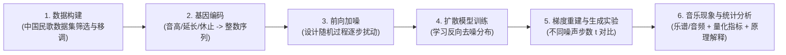

# 小组期中课题说明与实操手册：旋律的扰动与重建

> [!NOTE]
> 本文档面向小组全体成员（含零乐理或未完整跟进课堂推导的同学），将课题要求、核心原理、数据集避坑指南、模型实现路线、实验分析方案与分工计划汇总为一页式参考手册。

---

## 一、 课题全景与研究主线

本课题要求结合**随机过程**与**扩散模型（Diffusion Models）**，以中国传统单声部民歌为研究对象，完成从数据编码到生成分析的完整研究闭环：

一句话理解我们要回答的科学问题：**当我们用随机过程逐步“破坏”一段真实民歌的旋律基因，再用扩散模型把它一步步“修复/重构”回来时，不同破坏程度下，音乐的调式、轮廓、节奏或动机是怎么消失又怎么被模型抢救回来的？**

---

## 二、 核心概念通俗解读（零基础快速对齐）

### 1. 什么是旋律的“基因编码”？
就像生物 DNA 在一维序列的每个位点上排布 `A/T/C/G` 碱基一样，我们可以把单声部旋律按**固定时间网格**（例如每步代表一个**十六分音符**或**八分音符**）切分成等长序列，每个时间格子填一个整数，从而把**音高、休止、音符延长**统一装进一维整数数组里：

| 整数取值 | 符号含义 | 简谱类比 | 作用与必要性说明 |
| :--- | :--- | :--- | :--- |
| `0` | `REST`（休止） | `0` | 该时间步不发声（停顿/换气）。 |
| `1` | `HOLD`（延长） | `-`（增时线） | 继续延续上一时间步的音高。**不能省略**：没有 `HOLD` 就无法区分“连续唱两个短音 `5 5`”和“唱一个长音 `5 -`”。 |
| `2 ~ K+1` | `PITCH`（起音） | `1, 2, 3, 5, 6 ...` | 触发新音符的 MIDI 音高（如将 `MIDI 48~84` 映射为 `2~38`）。 |
| `K+2`（可选） | `[MASK]`（掩码） | `?` | 若使用掩码扩散模型（D3PM-Absorbing），用于表示被擦除/未知的位点。 |

**编码示例**（以 `1=C` 的 2 小节 `2/4` 拍、八分音符网格为例，`3 - 5 6 | 1̇ 6 5 0`）：
- 简谱时间格子：`[3, -, 5, 6, 1̇, 6, 5, 0]`
- 对应 MIDI 映射：`[64, HOLD, 67, 69, 72, 69, 67, REST]`
- 若记 `REST=0, HOLD=1, pitch_id = midi - 46`，则整数基因序列为：`[18, 1, 21, 23, 26, 23, 21, 0]`。

### 2. 什么是“随机过程”与“前向加噪”？
- **随机过程**：随时间步 $t = 0, 1, \dots, T$ 演变的随机状态序列 $X_0, X_1, \dots, X_T$。
- **马尔可夫链（Markov Chain）**：满足“无后效性”，即第 $t$ 步的分布只依赖第 $t-1$ 步：
  $$P(X_t \mid X_{t-1}, X_{t-2}, \dots, X_0) = P(X_t \mid X_{t-1})$$
- **前向加噪（Forward Process）**：从干净旋律 $x_0$ 出发，就像往清水里滴一滴墨水并不断搅拌。每走一步加一点随机扰动；步数 $t$ 越大，旋律越混乱；到达终点 $t = T$ 时，序列退化为纯随机噪声（或全 `[MASK]`）。**前向过程由我们人工设计数学规则，不需要神经网络学习。**

> [!WARNING]
> **常见致命误区：切勿直接对原始整数 ID 加连续高斯噪声！**
> `0 (REST)`、`1 (HOLD)` 和 `60 (C4)` 之间没有数值大小上的音高距离关系。如果在标量 `0, 1, 60` 上直接加 $\mathcal{N}(0, \sigma^2)$ 噪声并四舍五入，休止符会被噪音抬成超低音音符，导致语义完全错乱。离散序列要么采用**离散转移矩阵（D3PM / 掩码扩散）**，要么转为 **One-Hot 矩阵**后再做连续扩散。

### 3. 什么是“扩散模型”与“反向生成 / 重建”？
墨水散开容易，让浑浊的水**倒流**重新聚成一幅清晰的画却很难——这就是神经网络要学习的**反向过程（Reverse Process）**：
- **核心思想（化整为零）**：直接让模型从一团纯乱码一步猜出整首完美民歌很难；扩散模型让网络只学一个更容易的任务——**“给定噪声步数 $t$ 和当前带噪序列 $x_t$，预测干净序列 $x_0$（或如何恢复到更干净一步 $x_{t-1}$）”**。
- **课题第 3 题的两个核心操作区别**：
  - **重建（Reconstruction）**：先拿真实民歌 $x_0$，前向加噪到**中间某一步** $t$（例如破坏 `30%` 或 `70%`），再让模型从第 $t$ 步反向修补回 $0$。可用于研究“噪声多大时原曲风格/骨架开始崩塌”。
  - **生成（Generation）**：直接从 $t = T$ 的**完全纯噪声**（`100%` 损坏 / 全 `[MASK]`）出发，一步步反向采样到 $0$，让模型从零创作全新的民歌片段。

### 4. 课题提及的 4 个核心音乐现象（零乐理速成）
| 音乐现象 | 通俗解释 | 在中国民歌中的特点 | 加噪与重建时可观察的变化 |
| :--- | :--- | :--- | :--- |
| **调式（Mode）** | 歌曲主要使用的音阶集合，以及最有“回家感”的结尾主音。 | 传统民歌以**五声调式**为主（简谱 `1 2 3 5 6`，即宫商角徵羽），较少出现 `4` 和 `7`。 | 加噪会引入大量半音/偏音导致“跑调”；反向去噪后期会把偏音拉回五声音阶（**调式吸引子效应**）。 |
| **旋律轮廓（Contour）** | 音高随时间起伏的连线形状（上行、下行、拱形起伏）。 | 民歌线条通常连续平滑，以二度级进和小三度跳进为主。 | 轻度噪声保留大轮廓仅微调局部（类似民间“加花”）；重度噪声下轮廓打散，但局部仍维持级进习惯。 |
| **节奏（Rhythm）** | 音符长短、起音密度与停顿的搭配。 | 强拍起音稳，乐句尾部常有长音（`HOLD`）和呼吸停顿（`REST`）。 | 随机加噪易把长音切碎成急促十六分音符；看模型能否重新合出长音与乐句停顿。 |
| **重复动机（Motif）** | 一小段 2~4 个音的标志性核心乐汇反复或变奏出现。 | 民歌常采用“起承转合”“换头合尾”或局部模进。 | 若一段旋律前半被重度遮挡而保留后半，双向模型往往会“借用”未损坏小节的动机去补全损坏部分。 |

---

## 三、 数据集获取与清洗避坑指南（对应要求 1）

课题指定的参考仓库为：[Anthology-of-Chinese-Folk-Songs](https://github.com/m-july/Anthology-of-Chinese-Folk-Songs)（收录《中国民间歌曲集成》14 卷共 10,481 条记录，由简谱 OMR 识别生成）。**动手前务必注意以下仓库实情：**

> [!IMPORTANT]
> **仅执行 `git clone` 无法拿到乐谱文件！**
> 该 Git 仓库主分支只存放 `metadata/` 元数据（JSONL）和 `tools/` 工具脚本；真正的 `.musicxml` 和 `.mid` 乐谱文件打包在 **[v261104 Release](https://github.com/m-july/Anthology-of-Chinese-Folk-Songs/releases/tag/v261104)** 的 11 个分省压缩包中。小组实验前期只需下载 1~2 个省份（如江苏 `ACFS-v261103-scores-jiangsu.zip` 约 76 MiB、1,424 首），再使用仓库自带的 `tools/manage_assets.py` 解压核验即可。

### 推荐数据预处理流水线
1. **排除空文件与异常记录**：
   - 过滤掉 `empty_score == true` 的空占位条目（仓库已知包含 `tianjin:582` 与 `tianjin:584`）。
   - 建议读取 `metadata/curated/<volume>.jsonl`（已合并人工校对字段）。
2. **节拍筛选（关键清洗步骤）**：
   - 数据集中包含 763 首**散板（`fields.meter.value == "散板"`）**，无固定节拍小节线，且 OMR 识别的个别小节可能存在时值误差。
   - **建议**：初版实验仅挑选拍号规整的 `2/4` 或 `4/4` 拍民歌（可先选 500~1,500 首高质量曲目），并检查总时长与小节数是否对齐。
3. **统一移调（Transposition Normalization）**：
   - 民歌原调各不相同（元数据 `fields.tonic.value` 如 `1=♭E`、`1=G`、`6=♯F` 等）。如果不移调直接训练，同一五声调式会分散在 12 个调上，导致小样本训练失效。
   - **建议**：利用 `music21` 结合曲目 `tonic` 字段（或采用 Krumhansl/五声音阶匹配算法辅助校验），将所有样本统一移调至 **首调 `1 = C`（中央 `C = MIDI 60`）**。
4. **切窗与定长编码**：
   - 以**十六分音符**为 1 步，用滑动窗口切分固定长度序列，例如 **4 小节 `4/4` 拍 = 64 步**（或 8 小节 `2/4` 拍 = 64 步，足够包含完整的一两句民歌乐句）。
   - **自检步骤**：编写 `encode()` 和 `decode()` 后，务必抽查 5 首原曲执行“编码 → 立即解码 → 播放试听”，确认十六分音符量化不会丢掉关键旋律韵味。

---

## 四、 扩散模型实现方案建议（对应要求 2）

提供两套实现路线，**强烈建议主选路线 A**（数学与代码最契合整数编码，笔记本电脑即可快速训练收敛）；若小组成员更熟悉课堂的经典连续 DDPM 公式，可选路线 B 或作为对比实验。

### 路线 A（首选推荐）：离散扩散模型（D3PM / Masked Diffusion）

#### 1. 前向加噪设计（可任选一种，或做两者对比！）
- **方式 A1：吸收态掩码扩散（Absorbing / Masked Diffusion）—— 最易实现、最稳定**
  在词表末尾增加 `[MASK]`（记为 `V-1`）。给定调度参数 $\bar{\alpha}_t \in [0, 1]$（随 $t$ 从 `1` 单调降至 `0`，如余弦调度），任意第 $t$ 步可直接一步采样得到：
  $$q(x_t^{(i)} \mid x_0^{(i)}) = \bar{\alpha}_t \, \delta_{x_t^{(i)}, x_0^{(i)}} + (1 - \bar{\alpha}_t) \, \delta_{x_t^{(i)}, \text{[MASK]}}$$
- **方式 A2：音乐先验转移矩阵（Structured D3PM）—— 极佳报告创新点**
  定义单步转移矩阵 $Q_t$（大小 $V \times V$），利用累积矩阵 $\bar{Q}_t = Q_1 Q_2 \cdots Q_t$ 直接采样 $q(x_t \mid x_0)$。设计音乐先验：
  - 音高 token 在小噪声步更容易向邻近半音（$\pm 1, \pm 2$）发生局部抖动（离散高斯核）；
  - 音高、`HOLD`、`REST` 之间以较小概率互换，且保证当 $t \to T$ 时趋向均匀分布。

#### 2. 反向去噪网络与训练
- **网络结构**：2~4 层双向 **Transformer Encoder**（`d_model = 128` 或 `256`，`nhead = 4`），输入为序列嵌入 `Embedding(x_t) + PosEmb + TimeEmb(t)`，输出每个位置的词表对数概率（Logits，形状 `(B, L, V)`）。总参数量通常不到 100 万，CPU 或单卡 GPU 数分钟即可收敛。
- **训练损失**：直接预测干净序列的对数概率 $p_\theta(x_0 \mid x_t, t)$，在被掩码或扰动的位置计算交叉熵损失（Cross-Entropy Loss），或结合 D3PM 变分下界与辅助交叉熵混合损失。
- **反向采样（$t = T \to 0$）**：在掩码扩散中，从全 `[MASK]`（或部分保留序列）出发，每步用模型预测 $\hat{x}_0$，按调度比例逐步锁定置信度最高的几个位置并保持其余位置进入下一步迭代（或按后验 $q(x_{t-1} \mid x_t, \hat{x}_0)$ 采样）。

### 路线 B（备选）：One-Hot 连续空间 DDPM
若课堂严格围绕连续高斯 DDPM 推导：
1. 将长度为 `L` 的整数序列转成 `(L, V)` 的 One-Hot 矩阵，线性缩放到 `[-1, 1]` 作为 $\mathbf{x}_0$。
2. 按标准 DDPM 公式加高斯噪声：$\mathbf{x}_t = \sqrt{\bar{\alpha}_t}\mathbf{x}_0 + \sqrt{1 - \bar{\alpha}_t}\boldsymbol{\epsilon}$。
3. 使用 1D U-Net 或 Transformer 预测噪声 $\boldsymbol{\epsilon}_\theta(\mathbf{x}_t, t)$（MSE 损失）。
4. 反向去噪采样结束后，在最后一维对每个时间步取 `argmax`，还原回整数基因序列。

---

## 五、 实验设计、统计分析与报告规范（对应要求 3–4）

### 1. 建议必做的两组核心实验
1. **噪声梯度重建扫描实验**：选取 5~10 首未参与训练的测试集民歌，分别加噪至 $t/T \in \{10\%, 30\%, 50\%, 70\%, 90\%, 100\%\}$，记录并对比三态序列：**原曲（Original）→ 加噪后（Noised）→ 模型重建（Reconstructed）**。
2. **加噪策略对比或消融（可选加分项）**：对比“全随机掩码加噪”与“音高邻域局部扰动”在中等噪声（如 `50%`）下谁更能保住节奏骨架或调式特征。

### 2. 统计分析指标参考（挑 1~2 个音乐现象做深做透）
| 研究方向 | 推荐量化统计指标（画出随噪声比例 `t/T` 变化的折线图） | 理论解释切入点 |
| :--- | :--- | :--- |
| **调式（推荐首选）** | 1. 五声骨干音占比（`{C, D, E, G, A}` 占所有发声步比例） 2. 音高分布直方图与训练集的 **KL / JS 散度** 3. 乐段尾音落回主音/宫音/徵音的比例 | 观察反向扩散如何将噪声引入的半音偏音“吸附”回五声音阶流形（吸引子效应）。 |
| **旋律轮廓** | 1. Parsons Code（上行/下行/保持方向序列）与原曲的相关性 2. 二度级进 vs 大跳（$> 5$ 半音）比例 | 解释局部上下文注意力如何在高噪声下丢掉全局轮廓，却仍能维持符合人声习惯的平稳级进。 |
| **节奏规律** | 1. 起音密度（`Note-On` 占比）与平均音符时值 2. `HOLD` 与 `REST` 占比变化 | 解释均匀噪声造成的“节奏碎裂化”，以及模型如何重建长音与乐句喘息停顿。 |
| **重复动机** | 1. 4-step / 8-step 音高-节奏模体重复率 2. 时间自相似矩阵（Self-Similarity Matrix） | 分析双向模型在局部掩码重建时如何从相邻小节提取重复动机完成“换头合尾”。 |

### 3. 研究报告与附件提交清单
- **报告核心章节**：问题背景 → 数据筛选与基因编码细节 → 扩散模型数学原理与网络结构 → 多噪声梯度实验结果与统计图表 → 音乐学现象分析与**客观局限性反思**（例如如实说明 OMR 数据自身时值噪声、十六分音符量化对装饰音/三连音的近似损失、无条件长序列容易结构松散等）→ 软件工具与参考文献。
- **必须附带的材料**：
  - **乐谱对照图**：用 `music21` 导出 `.musicxml` 后通过 MuseScore 批量渲染成高清乐谱图片，辅以钢琴卷帘图（Piano Roll）直观展示序列演化。
  - **音频附件**：用 `FluidSynth` + 音色库（`.sf2`）将 MIDI 渲染成 `.wav`/`.mp3`（建议按 `song01_orig.wav`、`song01_t50_noised.wav`、`song01_t50_recon.wav` 规范命名）。
  - **代码与环境说明**：注明 `Python`、`PyTorch`、`music21`、`FluidSynth`、`MuseScore` 等版本号及可复现脚本。

---

## 六、 小组分工与时间推进参考（3–4 人）

| 角色 | 核心职责 | 交付物 |
| :--- | :--- | :--- |
| **数据与编解码负责（1 人）** | 从 Release 下载并验证省份数据；按拍号/非散板清洗；编写 `music21` 移调与双向 `encode/decode` 脚本。 | 清洗后的序列数据集 `.npy`/`.pt`、编码字典说明、无损校验音频。 |
| **模型与随机过程负责（1–2 人）** | 实现前向加噪调度与简化扩散模型（推荐 PyTorch 轻量 Transformer）；完成训练并保存权重；提供梯度加噪与重建采样接口。 | 训练收敛曲线、加噪/重建推理脚本、模型结构图。 |
| **实验分析与渲染负责（1 人）** | 批量跑通噪声梯度实验；计算五声占比、KL 散度、轮廓/自相似等指标并出图；渲染乐谱对比图与 `.wav` 音频。 | 统计折线图、Piano Roll 演化图、乐谱与音频附件包。 |
| **统稿与汇报（全员协作）** | 对齐实验数据与音乐学听感评价，撰写完整研究报告与致谢/参考文献。 | 完整研究报告（PDF/Word）及答辩演示文稿。 |

---

## 七、 可直接引用的参考文献
1. Bu, F., Li, R., Li, Z., Li, Y., Fan, L., & Huang, P. (2025). *The Renaissance of Expert Systems: Optical Recognition of Printed Chinese Jianpu Musical Scores with Lyrics*. [arXiv:2512.14758](https://arxiv.org/abs/2512.14758)（对应数据集参考资料 `[1]`）
2. Ho, J., Jain, A., & Abbeel, P. (2020). *Denoising Diffusion Probabilistic Models*. NeurIPS 2020.
3. Austin, J., Johnson, D. D., Ho, J., Tarlow, D., & van den Berg, R. (2021). *Structured Denoising Diffusion Models in Discrete State-Spaces*. NeurIPS 2021. [arXiv:2107.03006](https://arxiv.org/abs/2107.03006)
4. Mittal, G., Engel, J., Hawthorne, C., & Simon, I. (2021). *Symbolic Music Generation with Diffusion Models*. ISMIR 2021. [arXiv:2103.16091](https://arxiv.org/abs/2103.16091)
5. Plasser, M., Peter, S., & Widmer, G. (2023). *Discrete Diffusion Probabilistic Models for Symbolic Music Generation*. IJCAI 2023. [arXiv:2305.09489](https://arxiv.org/abs/2305.09489)
6. Liu, Y., Jiang, M., Gamboa, H., Xue, B., & Schultz, T. (2022). *Bell Shape Embodying Zhongyong: The Pitch Histogram of Traditional Chinese Anhemitonic Pentatonic Folk Songs*. *Applied Sciences*, 12(16), 8343. [MDPI](https://www.mdpi.com/2076-3417/12/16/8343)
