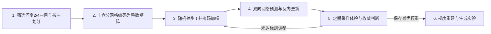

# 旋律扩散模型训练与实验操作步骤指南（河南 `2/4` · 十六分音符 · 掩码扩散定稿版）

> [!NOTE]
> 本文档为纯步骤与规范说明（不含代码实现），供小组成员对齐训练流程、参数标准、验收指标及排查方法使用。技术路线已全面锁定：**河南民歌 `2/4` 子集 + 十六分音符时间网格（每小节 8 步，`L = 64`） + 掩码扩散模型（Masked Diffusion）**。

---

## 整体训练与实验流程

---

## 阶段一：河南数据准备与十六分音符网格编码

基于对参考仓库 `Anthology-of-Chinese-Folk-Songs` 中河南卷（`metadata/curated/henan.jsonl` 与 `ACFS-v261103-scores-henan.zip`）的实测统计，按以下 5 步完成数据处理：

1. **筛选合规曲目（聚焦 `2/4` 拍主力语料）**
   - 河南卷共 987 首乐谱（无空文件），其中 **`2/4` 拍高达 866 首（占 87.7%）**，另有散板 39 首、3/4 拍 30 首、4/4 拍 23 首等。
   - **执行规则**：仅保留 **`fields.meter.value == "2/4"`** 的 866 首作为统一节拍语料，天然排除散板与杂拍子干扰。
2. **两个必须注意的实测数据暗坑（极易踩雷）**
   - **无需再按 `tonic` 字段移调**：实测河南全部 866 首 `2/4` MusicXML 的调号 `fifths` 均已设为 `0`，乐谱已直接按简谱**首调 `1 = C`** 记谱（五声骨干音 `C/D/E/G/A` 原生占比达 **95.7%**）。切勿再根据表头的 `1=F`、`1=D` 等字样做二次移调，否则反而会打乱调性！
   - **切勿依赖 MusicXML 内部 `<time>` 标签切小节**：实测该批文件 XML 内的 `<time>` 默认都写成了 `4/4`，必须以元数据 `2/4` 及每小节真实时值总和（2 拍 = 8 个十六分单位）为准来判断完整小节。
   - **剔除异常时值小节**：约 19.9% 的小节存在非 2 拍总长（弱起、变拍或 OMR 误差）及极少量零时值 32 分音符。切片时只提取**连续满 2 拍且无零时值音符**的干净片段即可（按 8 小节滑窗、步长 2 小节，实测可获得约 **3,000 条**高质量干净片段）。
3. **划分数据集（防数据泄漏核心步骤）**
   - **必须先按原曲目 ID 划分**训练集（约 85%）与验证/测试集（约 15%），**再**各自执行滑窗切片，严禁先切片再打乱划分。
4. **选定时间网格：十六分音符（`2/4` 每小节 8 步，8 小节 `L = 64`）**
   - 实测依据：200 首河南 `2/4` 民歌（23,443 个音符）中，八分音符占 **46.5%**、四分音符占 **25.7%**、**十六分音符占 25.1%**、附点八分音符占 **2.8%**，三十二分音符仅占 **0.4%**；且全部 866 份 MusicXML 原生时间精度 `divisions = 4`（1 单位恰好等于 1 个十六分音符）。
   - 采用十六分音符网格可精确对齐 **99.5%+** 的音符与附点节奏，几乎零失真；每 `8` 步为一小节，取连续 `8` 小节即 `L = 64` 步。
5. **词表与编码规范**
   - 实测 MIDI `48 (C3) ~ 84 (C6)` 覆盖了河南 `2/4` 曲库 **99.96%** 的音符。词表固定为（总大小 `V = 40`）：`0` = 休止 `REST`、`1` = 延长 `HOLD`、`2 ~ 38` = `MIDI 48 ~ 84`、`39` = 掩码 `[MASK]`。
   - 编码后抽检 5 首原曲执行“编码 → 立即解码 → 试听”，确认无节拍错位或音高失真。

---

## 阶段二：掩码扩散前向加噪配置（制作训练样本对）

掩码扩散（Absorbing / Masked Diffusion）训练时**不需要**循环运行 `T` 步，而是在每个训练批次（Batch）随机抽取时间步并一步完成加噪：

1. **设定总步数与调度曲线**
   - 设定总扩散步数 `T = 50`，掩码比例按线性调度 $\gamma_t = t / T$（从 `t = 1` 的 2% 轻度遮挡递增到 `t = 50` 的 100% 全遮挡），也可对比余弦调度。
2. **每个 Batch 的动态掩码流程**
   - **随机抽步**：为当前批次的每条干净旋律 $x_0$，独立均匀抽取一个时间步 $t \in \{1, \dots, T\}$。
   - **生成掩码样本 $x_t$**：对序列中的每个位置，以概率 $\gamma_t$ 独立替换为掩码符号 `39 ([MASK])`，未命中位置保留原值，同时记录掩码位置集合 $\mathcal{M}_t$（若极少数样本恰好无任何位置被掩码，强制掩码至少 1 个位点）。

---

## 阶段三：去噪模型结构与损失函数设定

1. **网络主干选择**
   - 推荐使用 **2~4 层双向 Transformer Encoder**（轻量级即可，几十万至百万级参数）。
   - **关键注意点**：不要使用自回归模型常见的下三角因果掩码（Causal Mask），去噪任务必须允许模型同时看到当前位点**前后两边的上下文**。
2. **输入特征融合（决定节奏感的关键）**
   - **词元嵌入**：将当前带噪序列 $x_t$ 的整数编号映射为向量。
   - **全局位置嵌入**：标明当前位于整段 `0 ~ L-1` 的第几步。
   - **小节内节拍位置嵌入（强烈建议增加）**：河南主力数据为 `2/4` 拍、十六分音符网格（每小节 8 步），即通过 `pos % 8` 标明当前位于小节内的第几小拍。这能帮助模型感知“强拍”与“小节线”，防止生成节奏错位。
   - **时间步嵌入**：将当前噪声步 $t$ 编码为向量并注入模型，让网络知道“现在噪声有多严重、需要靠局部修补还是靠全局脑补”。
3. **输出与损失计算**
   - 模型输出每个时间步在词表上的预测概率分布，形状为 `(Batch, L, 40)`。
   - **掩码扩散损失**：仅在被 `[MASK]` 遮盖的位点 $\mathcal{M}_t$ 上，计算模型预测分布与真实原曲 $x_0$ 之间的交叉熵损失（Cross-Entropy Loss）：
     $$\mathcal{L}(\theta) = \mathbb{E}_{x_0,\, t}\left[\,\frac{1}{|\mathcal{M}_t|}\sum_{i \in \mathcal{M}_t} -\log p_\theta\big(x_0^{(i)} \mid x_t, t\big)\,\right]$$

---

## 阶段四：模型训练、监控与异常排查

### 1. 起步训练参数建议
| 参数项 | 推荐起步配置 | 说明与调整方向 |
| :--- | :--- | :--- |
| 序列长度 `L` | `64` | 对应 8 小节 `2/4` 拍（每小节 8 个十六分音符） |
| 扩散总步数 `T` | `50` | 步数太少曲线粗糙，太多则采样耗时增加 |
| 网络规模 | 隐藏层 `128`、注意力头 `4`、层数 `3~4` | 河南干净片段约 3,000 条，3 层已足够防过拟合 |
| 优化器与学习率 | `AdamW`，初始学习率 `3e-4` | 配合余弦退火调度与梯度裁剪（阈值 `1.0`） |
| 批次与正则化 | `Batch Size = 64`，`Dropout = 0.1` | 过拟合明显时可将 Dropout 提高至 `0.15~0.2` |
| 训练轮数 | `80 ~ 150 Epochs` | 以验证集指标和采样质量平稳为准，保存验证最优权重 |

### 2. 训练过程中的“四维体检”
每训练 10 个 Epoch，除记录训练集和验证集 Loss 曲线外，**必须抽取模型自动采样生成 20 条旋律**并检查以下 4 项指标：
1. **验证集 Loss**：确认未出现“训练 Loss 持续降、验证 Loss 反弹”的过拟合信号。
2. **语法合法率（孤立 `HOLD` 比例）**：统计休止符 `REST` 之后紧跟延长符 `HOLD`，或序列首位直接出现 `HOLD` 的比例。收敛良好的模型该错误率应**趋近于 0%**。
3. **五声调式纯度**：河南 `2/4` 民歌真实五声纯度高达 **95.7%**；随机生成采样应从初态约 `42%`（5/12）稳步攀升并稳定在 **90% 以上**。
4. **新颖度自检（防死记硬背）**：比对生成序列与训练集序列的最大连续重合长度。若生成片段几乎原封不动照抄某首训练曲，说明模型容量过大或训练过久，应及时早停并减小网络层数。

### 3. 常见问题排查表
| 异常现象 | 可能原因 | 解决步骤 |
| :--- | :--- | :--- |
| Loss 不降或生成调性混乱 | 误按表头 `tonic` 对已移调为 `1=C` 的曲目做了二次移调 | 检查提取到的原始音高是否主要落在 `C, D, E, G, A`，取消多余移调 |
| 小节切分错位、强拍紊乱 | 误信 XML 内默认的 `<time>4/4</time>` 标签而非实际小节时长 | 改按元数据 `2/4` 及每小节真实时长等于 2 拍来过滤与切窗 |
| 生成全是大片重复单音或长时间 `HOLD` | 采样温度过低，或模型过度迎合高频长音 | 提高采样温度（如 `0.9 ~ 1.0`），检查是否残留异常空白长音小节 |
| 音高乱跳、完全没有民歌味 | 未加入小节内拍点位置嵌入（`pos % 8`） | 加入小节内节拍位置嵌入，检查滑动窗口扩充数量是否充足 |
| 生成结果残留 `[MASK]` 或孤立 `HOLD` | 推理阶段未屏蔽 `[MASK]` 输出概率，或训练未充分收敛 | 采样时强制将 `[MASK]` 位概率置为负无穷，延长训练轮数 |

---

## 阶段五：训练完成后如何做实验（重建与生成）

拿到保存的最优模型权重后，按以下流程开展课题第 3 部分的实验：

1. **无条件从零生成实验（检验先验学习）**
   - 构造一条完全被 `39 ([MASK])` 填满的序列作为起点，时间步从 `t = T` 倒推到 `t = 1`。
   - 每一步模型预测干净序列的概率分布（强制屏蔽输出 `[MASK]` 的概率），按采样温度抽取候选音符，并依据反向后验概率（线性掩码调度下当前掩码位点解开概率为 `1 / t`）逐步揭示序列，直至 `t = 0` 全部还原。
2. **梯度噪声重建实验（课题核心分析）**
   - 从**测试集**（模型训练从未见过）挑选 5~10 首有代表性的河南民歌 $x_0$。
   - 分别前向掩码至多个比例梯度（例如 $t / T \in \{10\%, 30\%, 50\%, 70\%, 90\%, 100\%\}$），得到对应的遮挡版本 $x_{\text{masked}}$。
   - 将每个遮挡版本作为起点，从对应的 $t_{\text{start}}$ 开始执行反向去噪，得到重建版本 $x_{\text{recon}}$。
3. **音乐现象定量统计与听觉/视觉对照**
   - 针对自选研究现象（**调式、旋律轮廓、节奏或重复动机**），分别统计三组样本（原曲、掩码态、重建态）随掩码比例变化的数据指标（如五声调式率、KL 散度、起音密度、轮廓相关系数、自相似矩阵等），绘制对比折线图。
   - 挑选 1~2 个最具代表性的梯度案例，将序列解码回 MusicXML/MIDI，用 MuseScore 导出高清乐谱对照图，并用 FluidSynth 渲染成 `.wav` 音频进行主观听感验证与原理解释。

---

## 阶段六：小组执行验收 Checklist

- [ ] **数据端**：已锁定河南 `2/4` 子集，未做多余移调，已过滤异常时长小节，且按**原曲 ID** 隔离训练集与测试集；编码→解码试听无损。
- [ ] **训练端**：已记录训练/验证 Loss 收敛曲线；随机生成样品的孤立 `HOLD` 接近 0%，五声纯度稳定在 90% 以上，且非简单抄袭训练集。
- [ ] **实验端**：已完成至少 5 档以上掩码比例梯度的重建对比实验，拥有完整的统计图表与定量分析。
- [ ] **成果端**：已齐备典型病例的**三态乐谱对照图**（原曲 / 掩码加噪 / 重建）、**对应音频文件**、使用的软件环境版本及规范参考文献列表。
